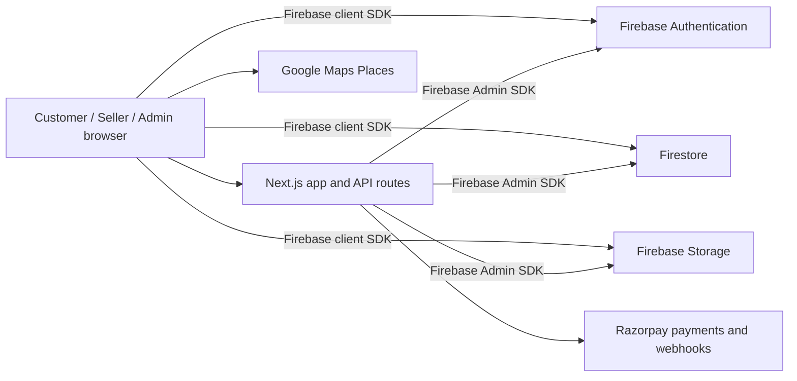
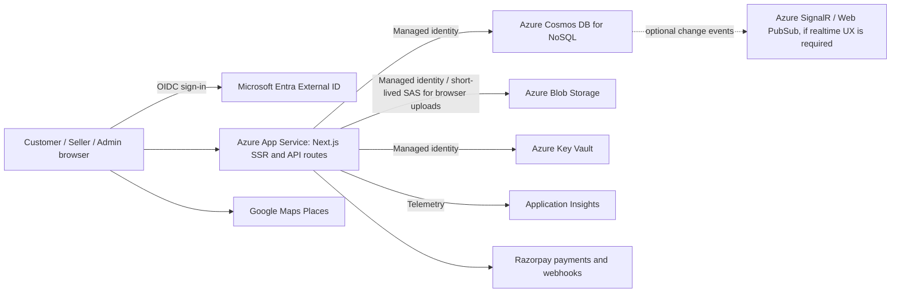

# Migration Assessment Report

## 1. Executive Summary

| Property | Value |
|----------|-------|
| **Application Name** | casaio-project |
| **Application Type** | Full-stack web app (Next.js SSR + API routes) |
| **Source Platform** | Firebase-managed Auth, Firestore, and Storage; current web hosting is unspecified |
| **Source Runtime** | Node.js 22.16.0 in the local environment; Next.js 16.4.2 / React 19 / TypeScript |
| **Target Platform** | Azure App Service (Linux), provisional recommendation |
| **Target Runtime** | Node.js 24 LTS, subject to current App Service availability at deployment time |
| **Migration Readiness** | Medium |
| **Estimated Effort** | High |
| **Assessment Date** | 2026-10-22 |

This is not a lift-and-shift. The source contains Firebase SDK usage in 45 files, including browser-side data access, server-side Admin SDK routes, authentication/session code, uploads, and business transactions. There are 30 API route files. Firebase replacement will require a coordinated data, identity, authorization, and application-code migration. The source folder was not modified during this assessment.

App Service is the provisional host because the application uses Next.js server rendering and numerous API routes. Azure Static Web Apps hybrid Next.js support is documented as Preview, so it is not the recommended production default for this workload. The final hosting tier and Azure region remain undecided.

## 2. Application Inventory

| # | Component | Runtime | Type | Instances | Description |
|---|-----------|------|------|-----------|-------------|
| 1 | casaio-project | Node.js / Next.js 16.4.2 | Web | Unknown; not currently deployed in Azure | Customer storefront, account, seller and admin portals, server API routes, checkout, catalog, reviews, and order fulfillment |

External services detected:

- Firebase Authentication, Firestore, and Firebase Storage
- Razorpay payments and webhooks
- Google Maps Places autocomplete

The app has a broad e-commerce workflow, but this migration does not itself add supplier integrations or realtime order/inventory subscriptions. The current seller fulfillment workflow accepts manually entered tracking and delivery milestones.

## 3. Service Mapping

| Source Service | Azure Equivalent | Migration Complexity | Notes |
|----------------|------------------|----------------------|-------|
| Next.js server-rendered app and 30 API routes | Azure App Service on Linux | Medium | Keep the Next.js app and API routes together initially; use the supported Node LTS runtime and `npm start`. |
| Firebase Authentication | Microsoft Entra External ID | High | Replace email/password, Google sign-in, verification/reset flows, session-cookie issuance, and role checks. Plan user/account cutover and password handling. |
| Firebase Admin SDK | Azure SDKs with App Service managed identity | High | Remove service-account credentials; grant least-privilege data-plane access to Cosmos DB and Blob Storage. |
| Firestore | Azure Cosmos DB for NoSQL | High | Migrate collections and indexes; choose partition keys from actual query and transaction patterns. Checkout/inventory atomicity needs redesign and testing. |
| Firestore Security Rules | Server API authorization using Entra claims/app roles plus scoped data access | High | Existing rules enforce customer, seller, and admin boundaries. Reproduce these controls in every API and upload flow; do not expose Cosmos credentials to browsers. |
| Firebase Storage | Azure Blob Storage | Medium/High | Product/review images, avatars, and private KYC documents need access-tier and privacy mapping. Use short-lived, least-privilege user-delegation SAS for browser uploads where needed. |
| Razorpay | Keep Razorpay | Low | No Azure replacement needed. Keep secrets in Key Vault and retain signature verification/reconciliation behavior. |
| Google Maps Places | Keep Google Maps | Low | Continue using the Places API; restrict the key according to whether it is used server-side or in the browser. |
| Firebase Emulator/rules tests | Cosmos DB-compatible integration tests and API authorization tests | Medium | Rewrite rule tests around the migrated authorization/data access model; preserve checkout, payment, and fulfillment regression coverage. |
| No existing CI/CD or IaC detected | GitHub Actions + Bicep/azd (after approval) | Medium | Infrastructure and pipeline generation belong in the later Azure preparation phase. |

Microsoft recommends an explicit Entra External ID migration plan, including inventory of users and auth flows. Credential handling can use a planned credential migration approach or a user password reset; this is a product decision, not safe to assume.

## 4. Compute & Scaling Mapping

| # | Source Config | Value | Azure Equivalent | Azure Value | Notes |
|---|-------------|-------|------------------|-------------|-------|
| 1 | Runtime | Local Node.js 22.16.0; no `engines` field | App Service runtime | Node.js 24 LTS, pinned in project and App Service | Microsoft App Service documentation currently shows the `24-lts` runtime. Recheck availability before deployment. |
| 2 | Startup | `npm run start` → `next start` | App Service startup | `npm start` | Ensure the selected runtime honors App Service `PORT`; validate the production build in the target environment. |
| 3 | Instance size | No source deployment config | App Service Plan SKU | Undecided | Production traffic, availability, budget, and scale needs were not supplied. Standard or Premium is a starting point for production; obtain user approval before selecting a tier. |
| 4 | Auto-scaling | Not detected | App Service autoscale | Undecided | Set only after expected load and service-level objectives are known. |
| 5 | Health check | No `/health` or `/healthz` API route found | App Service Health Check | Add a lightweight endpoint, e.g. `/healthz` | Health probe must not depend on mutable checkout state. |

## 5. Dependencies Analysis

| # | Package/Library | Version | Platform-Specific? | Azure Equivalent | Compatible? | Notes |
|---|----------------|---------|---------------------|------------------|-------------|-------|
| 1 | `next` | 16.4.2 | No | None required | Yes, subject to build validation | Server-rendered Next.js is appropriate for App Service. |
| 2 | `react`, `react-dom` | 19.2.8 | No | None required | Yes | UI dependencies. |
| 3 | `firebase` | ^12.19.0 | Yes | Entra External ID, Cosmos DB, Blob Storage, and app APIs | No direct substitution | Core client SDK appears across storefront, account, seller, admin, and checkout flows. |
| 4 | `firebase-admin` | ^14.5.0 | Yes | Azure SDKs authenticated with managed identity | No direct substitution | Server routes currently rely on Admin Auth, Firestore, and Storage. |
| 5 | `razorpay` | ^2.9.8 | No | Keep Razorpay | Yes | Retain payment and webhook implementation; move secrets to Key Vault. |
| 6 | Firebase tooling and rules tests | `firebase-tools` ^15.34.0; rules testing ^5.0.2 | Yes | Azure-specific test harness and CI | Requires rewrite | The existing emulator/rules tests cannot validate the migrated authorization model as-is. |
| 7 | `zod`, `clsx`, `tailwind-merge`, `lucide-react` | See `package.json` | No | None required | Yes | General application libraries. |
| 8 | `re2` (optional dependency of dev-only Firebase tooling) | Lockfile-resolved | Native/optional | None required | Needs build check | `node-gyp` is present under optional dev-only `re2`; not evidence by itself that production code requires native compilation. |

Static package review found a root `package-lock.json`, Next build/start scripts, and no undeclared external imports in config files and the first 20 source files checked. No build, install, lint, or test command was run.

## 6. Environment Variables & Configuration

| # | Source Variable | Purpose | Azure Equivalent | Auth Method | Notes |
|---|---------------|---------|------------------|-------------|-------|
| 1 | `NEXT_PUBLIC_FIREBASE_*` | Browser Firebase project configuration | Entra tenant/client configuration and app settings | Public client identifiers only | Remove Firebase variables after the identity/client migration; never put client secrets in `NEXT_PUBLIC_*`. |
| 2 | `FIREBASE_PROJECT_ID` | Firebase Admin project selection | Cosmos DB account/database settings | App Setting | Project identifier is no longer needed after migration. |
| 3 | `FIREBASE_CLIENT_EMAIL`, `FIREBASE_PRIVATE_KEY` | Firebase Admin service-account authentication | App Service managed identity | Managed identity / `DefaultAzureCredential` | Remove service-account private keys from Azure configuration. |
| 4 | `RAZORPAY_KEY_ID`, `RAZORPAY_KEY_SECRET`, `RAZORPAY_WEBHOOK_SECRET` | Payment gateway | Key Vault references to App Settings | Managed identity to Key Vault | Keep keys server-side. The checked `.env.local` is missing `RAZORPAY_MODE`, `RAZORPAY_KEY_SECRET_MODE`, and `RAZORPAY_WEBHOOK_SECRET_MODE`; configure matching modes before payment testing. |
| 5 | `RAZORPAY_MODE`, `RAZORPAY_LIVE_PAYMENTS_ENABLED`, mode selectors | Select and guard test/live payment configuration | App Settings plus Key Vault references | App Setting / managed identity | Preserve explicit live-mode opt-in and mode matching. |
| 6 | `NEXT_PUBLIC_GOOGLE_MAPS_API_KEY` | Places autocomplete | App Setting or browser configuration | Restricted Google API key | If browser-visible, restrict by allowed referrers and API scope. |
| 7 | `NEXT_PUBLIC_APP_URL` | Canonical URL, redirects, metadata | App Setting and App Service custom domain | App Setting | Align Entra redirect URIs, allowed origins, and HTTPS domain. |
| 8 | Azure database/storage settings | New Azure resource names and endpoint configuration | App Settings / App Configuration | Managed identity | No Cosmos or Storage configuration exists yet; do not add access keys to source. |

The current `.env.local` Firebase project identifiers match `.firebaserc`, but `.env.example` contains a different sample Firebase project identifier. The example should be corrected before it is used for a fresh setup.

## 7. Architecture Diagrams

### 7a. Current State (Source Platform)

Current hosting is unspecified; the repository supports local Next.js development and startup.

### 7b. Target State (Azure)

The realtime service is optional and is not included in an implementation scope until the desired update semantics are confirmed. The target keeps business APIs server-side so the browser never receives Cosmos DB credentials.

## 8. Data Services Mapping

| Source Database/Storage | Azure Equivalent | Migration Path | Notes |
|------------------------|------------------|----------------|-------|
| Firestore collections: users, sellers, categories, products, productPrivate, carts, wishlists, addresses, orders, checkoutRequests, coupons/couponCodes, couponUserUsage, reservations, reviews, notifications | Cosmos DB for NoSQL | Export, transform, and import documents; preserve stable IDs and required indexes/query behavior | Select partition keys from real access patterns. Checkout updates products, reservations, coupons, and orders transactionally today; this requires an explicit consistency/compensation design in Cosmos. |
| Firestore indexes | Cosmos DB indexing policy and query design | Review each query and translate indexes/partition filters | Firestore composite indexes do not translate one-to-one. |
| Firebase Storage: product/review images, avatars, seller KYC documents | Azure Blob Storage | Copy blobs and metadata; separate public storefront media from private KYC containers | Maintain private access for KYC and issue least-privilege, short-lived upload access. |
| Firebase Auth users and provider identities | Entra External ID | Inventory, transform needed profile attributes, create External ID users, stage and cut over sign-in | Decide JIT credential migration vs. password reset; test Google identity linking and email verification. |
| Firebase rules / auth-based access | Entra claims/app roles + server API authorization + Azure RBAC | Translate every rule and route role check into tested API authorization | Keep seller/customer/admin data boundaries and KYC privacy. |

Cosmos data modeling should be based on query and write patterns rather than a mechanical copy of Firestore collections. Validate order/inventory concurrency, uniqueness, coupon reservations, and multi-seller projections before cutover.

## 9. Networking & Security Mapping

| Source Feature | Azure Equivalent | Notes |
|---------------|------------------|-------|
| Firebase session cookies and role profiles | Entra External ID OIDC, secure App Service session handling, app roles/claims | Replace client and server auth together; preserve role verification for customer, approved seller, and admin operations. |
| Firebase Admin service-account credentials | App Service managed identity | Use least-privilege Cosmos and Storage data-plane roles; use Key Vault references for Razorpay secrets. |
| Firestore/Storage rules | Server API authorization and Blob access controls | Browser-side direct database access should be removed or replaced with narrow API endpoints. |
| Product and review uploads | Blob Storage plus short-lived user-delegation SAS | Restrict upload container, paths, content types, size, and expiry; keep seller KYC private. |
| HTTPS and custom domain | App Service HTTPS Only, managed certificate/custom domain | Configure secure cookies and Entra redirect URI allowlists. |
| Google Maps key | Google API key restrictions | Restrict allowed domains and Places API usage; key handling depends on server/browser call path. |
| Firebase project configuration | Azure App Configuration / App Settings | Keep environment-specific URLs and resource names out of hardcoded defaults. |
| No source network isolation config | App Service VNet integration/private endpoints, if required | Decide only after the security and data residency requirements are known. |

## 10. Monitoring & Observability Mapping

| Source Service | Azure Equivalent | Migration Notes |
|---------------|------------------|-----------------|
| Next.js application logs | Application Insights / App Service diagnostics | Add structured request/error telemetry without recording payment secrets or sensitive customer fields. |
| Firebase operational metrics | Azure Monitor metrics and alerts | Define alerts for HTTP failures, latency, authentication errors, database throttling, and payment webhook failures. |
| No distributed tracing integration detected | Application Insights OpenTelemetry | Instrument App Service and API routes; preserve correlation across checkout and webhook processing. |
| Firebase payment/order state reconciliation | Application Insights dashboards + operational alerts | Keep the existing reconciliation workflow and monitor unresolved payment states. |

## 11. CI/CD & Deployment Mapping

| Source Tool | Azure Equivalent | Notes |
|------------|------------------|-------|
| No GitHub Actions workflow found | GitHub Actions with Azure OIDC federation | Configure least-privilege federated identity; do not store a long-lived Azure client secret. |
| No IaC found | Bicep, optionally managed through `azd` | Create App Service, managed identity, Cosmos DB, Storage, Key Vault, and Application Insights only after requirements and approval. |
| `npm run build` / `npm run start` | App Service build and startup configuration | Pin Node 24 LTS and validate production build/start in a staging slot. |
| Firebase emulators and rules tests | Unit/integration tests against migrated adapters and an isolated Cosmos test environment | Rewrite authorization and transaction tests before cutover. |
| Firebase rules deploy command | Azure infrastructure/code deployment pipeline | Firebase rules are not deployed to Azure; equivalent controls must be part of the migrated API implementation. |

## 12. Recommendations

1. **Runtime**: Azure App Service Linux with Node.js 24 LTS; set the version in `package.json` and App Service configuration.
2. **App Service Plan**: Do not choose yet. For production, compare Standard and Premium based on traffic, availability, deployment-slot, and budget requirements.
3. **IaC Strategy**: Use Bicep/azd after the migration design is approved; the current environment has no Azure CLI or subscription context configured.
4. **Auth Strategy**: Microsoft Entra External ID for customers; define seller/admin role assignment and a user migration policy before changing login code.
5. **Monitoring**: Application Insights with Azure Monitor alerts for checkout, database, authentication, webhook, and API reliability.
6. **Data strategy**: Keep Cosmos DB access server-side with managed identity. Design partition keys and checkout inventory consistency before generating schemas or code.
7. **Storage strategy**: Use Blob Storage with managed identity for server operations and short-lived user-delegation SAS for controlled browser uploads.

## 13. Next Steps

- [x] Review source and produce a static Azure migration assessment
- [ ] Review and approve this assessment report
- [ ] Decide whether existing customer passwords should be migrated just-in-time or reset
- [ ] Confirm whether Cosmos DB NoSQL and an App Service-hosted Next.js app are acceptable target choices
- [ ] If approved, create a migrated application copy in `casaio-project-azure/`; do not modify the source folder
- [ ] Validate the migrated app and data/auth behavior in an isolated staging environment
- [ ] Hand off to `azure-prepare` for IaC generation and later `azure-validate` / deployment

## Official References

- [Configure a Node.js app for Azure App Service](https://learn.microsoft.com/azure/app-service/configure-language-nodejs)
- [Deploy hybrid Next.js websites on Azure Static Web Apps (Preview)](https://learn.microsoft.com/azure/static-web-apps/deploy-nextjs-hybrid)
- [Plan and execute a migration to Microsoft Entra External ID](https://learn.microsoft.com/entra/external-id/customers/migrate-to-external-id)
- [Migrate users and credentials to Microsoft Entra External ID](https://learn.microsoft.com/entra/external-id/customers/how-to-migrate-users)
- [Data modeling in Azure Cosmos DB for NoSQL](https://learn.microsoft.com/azure/cosmos-db/modeling-data)
- [Create a user delegation SAS token with Azure Blob Storage and JavaScript](https://learn.microsoft.com/azure/storage/blobs/storage-blob-create-user-delegation-sas-javascript)
